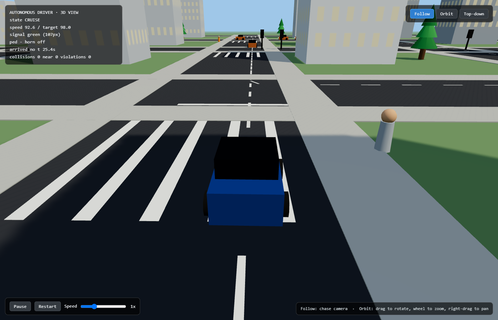

# Self-Driving Car

Plain HTML, CSS and JavaScript. No framework, no build step. Includes a world editor, an evolutionary training demo, and a 2D/3D city simulation.



## Run

```bash
python -m http.server 8000
```

Open:

- `http://localhost:8000/index.html` — straight-road training
- `http://localhost:8000/world/index.html` — world editor
- `http://localhost:8000/world/drive.html` — manual driving
- `http://localhost:8000/world/ai.html` — city training
- `http://localhost:8000/sim/index.html` — 2D simulation
- `http://localhost:8000/sim/3d.html?scene=city&blocks=6` — 3D city

The 3D page needs the local server because it uses ES modules.

## Commands

```bash
npm test              # unit tests
npm run train         # headless city training
npm run eval          # multi-seed evaluation
npm run sim           # headless simulation
npm run sim:city      # headless large city
npm run learn:train   # train a policy from the rule driver
npm run learn:bench   # compare policies
```

## Layout

- `js/` — straight-road demo
- `world/` — editor, manual drive, city training
- `sim/` — layered simulation, 3D view, learning harness
- `tools/` — headless runners
- `vendor/` — Three.js for the 3D view

Simulation details are in `sim/README.md`.
